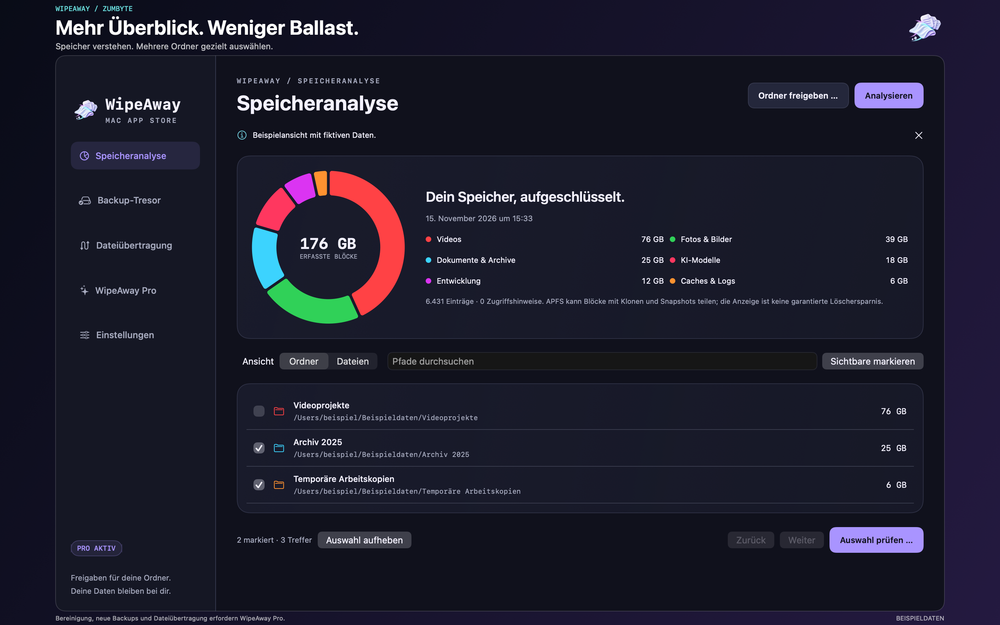

# WipeAway für macOS

**Verstehen. Aufräumen. Absichern.** WipeAway von Zumbyte bringt Speicheranalyse, gezieltes Aufräumen, App-Verwaltung und Backups in ein gemeinsames Kontrollzentrum für deinen Mac.

[Veröffentlichungen & Downloads](https://github.com/ZUMBYTE-AppSolution/WipeAway/releases) · [Zumbyte](https://www.zumbyte.de) · [Datenschutzhinweise](PRIVACY.md) · [Impressum](IMPRINT.md)

> **In Entwicklung.** WipeAway entsteht aus SEKTOR. Der neue Installer wird vor seiner öffentlichen Freigabe geprüft. Hier ist derzeit noch kein freigegebenes WipeAway-Installationspaket verfügbar. Die folgenden Vorschauen zeigen die native Store-Oberfläche mit gekennzeichneten Beispieldaten.

## Dein Mac, übersichtlich aufgeräumt

- **Speicher sichtbar machen:** große Dateien und Ordner finden, Datenarten und Speicherorte farbig vergleichen und gezielt auswählen.
- **Apps und ihre Reste verwalten:** mehrere Apps auswählen, zugehörige Dateien prüfen und eine gemeinsame Bereinigung vorbereiten.
- **Wächter in der Menüleiste:** entfernte Apps erkennen und gefundene Reste zur Auswahl anbieten. Der Anmeldestart öffnet kein Hauptfenster.
- **Kontrolle vor dem Löschen:** Auswahl und Vorschau, Quarantäne mit Wiederherstellung sowie ausdrücklich bestätigtes endgültiges Löschen.
- **Backups im Blick:** versionierte Sicherungen mit Prüfung und Wiederherstellung.
- **Eine Oberfläche für Tag und Nacht:** eigene Hell- und Dunkelgestaltung, einstellbar oder passend zum Mac.

Der Stand 0.5.0 enthält zusätzlich eine fortsetzbare Laufwerksanalyse, erklärbare Schutzregeln, einen Assistenten zur App-Auslagerung und die Lizenzanbindung. Der neue Installer wird vor der öffentlichen Freigabe am installierten Stand geprüft. Einschränkungen, insbesondere zur App-Auslagerung, stehen im [Änderungsprotokoll](CHANGELOG.md).

## Ein Blick in die Store-Ausgabe

Die Vorschauen stammen aus den tatsächlichen nativen Ansichten. Gezeigte Größen und Pfade sind fiktive Beispieldaten; das Backup entstand ausschließlich aus eigenen Beispieldateien. Bereinigung, neue Backups und Dateiübertragung erfordern Pro.

[Hellmodus](assets/wipeaway-store-analysis-light.png) · [Backup-Tresor](assets/wipeaway-store-backup-dark.png) · [Apple-Tarife und Wiederherstellung](assets/wipeaway-store-pro-dark.png)

## Zwei Ausgaben, klar beschrieben

| | Direkte Vollversion | Geplante Mac-App-Store-Ausgabe |
| --- | --- | --- |
| Bereitstellung | Signiertes und notarisiertes Installationspaket | Mac App Store, nach Apples Prüfung |
| Dateizugriff | Benutzerrechte und gezielt freigegebener Administrator-Helfer | Durch Apples Sandbox und erteilte Ordnerfreigaben begrenzt |
| Updates | Öffentlicher GitHub-Release-Feed und signierte Downloads | Über den Mac App Store |
| Administrator-Helfer | Nach persönlicher macOS-Freigabe | Nicht enthalten |

Die Store-Ausgabe ist für eine eigenständige Nutzung ohne zusätzliches Zumbyte-Konto ausgelegt. Ein erster Build wurde für interne Tests von Apple verarbeitet. Eine freiwillige Verbindung soll geprüfte Apple-Käufe auch für die direkte Vollversion nutzbar machen. Store-Ausgabe und Kaufübernahme sind noch nicht öffentlich freigegeben. Ein Downloadhinweis in der Store-App wird nur eingebunden, soweit Apples Regeln dies erlauben.

## Geplante Lizenzen

| Lizenz | Geplanter Preis in Deutschland |
| --- | ---: |
| Monatlich | 4,99 € / Monat |
| Jährlich | 39,99 € / Jahr |
| Lifetime | 249,99 € einmalig |

Für berechtigte Neukunden ist eine **14-tägige kostenlose Probephase** des Abos bei Apple eingerichtet. Sie gilt nicht für den Lifetime-Kauf. Die endgültigen, lokalisierten Preise, Verlängerungsbedingungen und die persönliche Berechtigung werden vor dem Kauf angezeigt. Apple-Abos werden über Apple verwaltet und gekündigt. Im [Zumbyte-Lizenzshop](https://zumbyte.de/licenses/) sind Programme und ihre Modelle getrennt dargestellt; WipeAway ist bis zur Produktfreigabe als Vorschau ohne Kaufmöglichkeit sichtbar.

## Lizenz und Lifetime-Geschenke

Die direkte Ausgabe 0.5.0 akzeptiert eine persönliche Website-Lizenz mit der zugehörigen E-Mail-Adresse sowie einen direkten Mac-Geschenkcode. Ein **WA-GIFT-Code** wird in WipeAway unter Einstellungen → WipeAway-Lizenz eingelöst. Ein **ZB-GIFT-Code** wird zuerst im Kundenportal eingelöst; anschließend werden der dort erhaltene persönliche Lizenzschlüssel und die E-Mail-Adresse in der App eingegeben. Bitte diese Codes und Schlüssel vertraulich behandeln.

Im Zumbyte-Adminbereich öffnet **Programme & Tools → WipeAway → Geschenkcodes** die passenden Funktionen. Einlöselimit und Sperrung eines Codes sind von bereits vergebenen Lizenzen getrennt. Für Geschenke innerhalb der Store-Ausgabe werden Apples Angebotscodes verwendet; deren produktive Verteilung setzt Apples Freigaben voraus. Eigene Website-Codes schalten die Store-Ausgabe nicht frei.

## Updates ohne GitHub-API

Die direkte Ausgabe erhält automatische und manuelle Updateprüfungen. Sie lädt einen öffentlichen, signierten Update-Feed aus den Release-Dateien – ohne GitHub-Konto, Zugriffstoken oder GitHub-API. Hintergrundprüfungen zeigen verfügbare Updates in WipeAway und der Menüleiste an. Du entscheidest über Download und Installation.

Update-Dateien werden zusätzlich zur Apple-Signatur mit einem eigenen Update-Schlüssel signiert. Die Prüfung erfolgt vor dem Entpacken. Automatische Prüfungen lassen sich abschalten. Für Änderungen am Administrator-Helfer kann macOS erneut eine persönliche Freigabe verlangen.

## Hilfe und Fehlerberichte

Kontakt: **[info@zumbyte.de](mailto:info@zumbyte.de)**. Der Stand 0.5.0 enthält eine integrierte Fehlerbericht- und Ticketfunktion mit Vorschau, freiwilligen Diagnoseangaben und eigenen Anhängen. Die Übermittlung erfolgt erst nach Bestätigung an Zumbyte. Weitere Angaben stehen in den [Datenschutzhinweisen](PRIVACY.md).

Bitte keine privaten Pfade, Zugangsdaten, Chats oder persönlichen Dateien in öffentliche GitHub-Issues schreiben. Scan-Ergebnisse und Backups sind keine öffentlichen Support-Anhänge.

## Über dieses Repository

Hier liegen ausschließlich **Produktinformationen, Bilder und fertige Releases**. Der App-Quellcode und die internen Entwicklungswerkzeuge werden hier nicht veröffentlicht. Die von GitHub automatisch angebotenen Quellarchive enthalten deshalb nur die öffentlichen Dokumente und Bilder.

**Systemvoraussetzung im aktuellen Entwicklungsstand:** macOS 14 oder neuer. Unterstützte Mac-Architekturen und geprüfte Einschränkungen werden pro Release angegeben.

© 2026 Zumbyte · AppSolution. Alle Rechte vorbehalten. [Nutzung und Rechte](LICENSE.txt).
